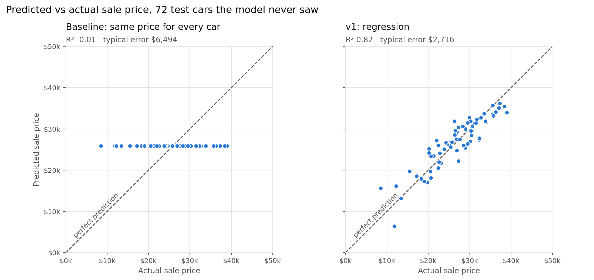

# Used car prices: regression results

## 1. Data and split

- `used_car_sales.csv`: 240 cars the dealer sold in the last year, 56 with an accident on record.
- Random 70/30 split (seed 42): 168 training cars, 72 test cars.
- `auction_lots.csv`: 40 cars from one recent auction, used only to test the buy rule.

## 2. Model

**Full model**: `Sale_Price ~ Mileage_K + Age_Years + Horsepower + C(Accident) + Num_Owners`

| Term | Coefficient | p-value |
|---|---|---|
| Intercept | 21,698.6 | < 0.0001 |
| C(Accident)[T.yes] | -2,171.8 | < 0.0001 |
| Mileage_K | -78.6 | < 0.0001 |
| Age_Years | -1,300.6 | < 0.0001 |
| Horsepower | 75.0 | < 0.0001 |
| Num_Owners | 62.9 | 0.8653 |

R² 0.8730, adjusted R² 0.8691.

**v1 (Num_Owners dropped)**: `Sale_Price ~ Mileage_K + Age_Years + Horsepower + C(Accident)`

| Term | Coefficient | p-value |
|---|---|---|
| Intercept | 21,762.4 | < 0.0001 |
| C(Accident)[T.yes] | -2,176.6 | < 0.0001 |
| Mileage_K | -78.2 | < 0.0001 |
| Age_Years | -1,291.6 | < 0.0001 |
| Horsepower | 75.0 | < 0.0001 |

R² 0.8730, adjusted R² 0.8698.

Num_Owners has p = 0.87 in the full model, and dropping it raises adjusted R² from 0.8691 to 0.8698. v1 is the model without it.

## 3. Fit on the test cars

| Model | R² | Typical error (RMSE) |
|---|---|---|
| Baseline (training average, $25,851) | -0.014 | $6,494 |
| v1 | 0.823 | $2,716 |
| v1 on its own training cars | 0.873 | $2,602 |

## 4. Decisions on the 40 auction lots

Rule: buy if auction price + $1,500 < predicted price, else pass (`should_buy` in car_regression.py). Profit per bought car = Later_Sale_Price - Auction_Price - 1,500.

| Rule | Cars bought | Money-losing cars bought | Total profit | Profit per car bought |
|---|---|---|---|---|
| Baseline | 14 | 10 | -$6,000 | -$429 |
| v1 | 17 | 6 | $15,800 | $929 |
| (for reference) buy all 40 | 40 | 27 | -$35,500 | |

Per-lot predictions and decisions: `car_auction_decisions.csv`.
