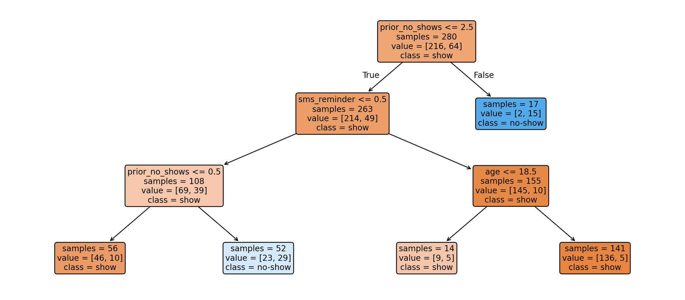

# Clinic no-shows: decision tree results

## 1. Data and split

- 400 appointments, 91 no-shows (22.8%).
- Train: 280 appointments, 64 no-shows (22.9%).
- Test: 120 appointments, 27 no-shows (22.5%).
- Stratified random split, seed 42.

## 2. Model v1

- Classification tree (CART, Gini), all 7 features offered, max depth 3, at least 10 training appointments per leaf, 5 leaves.
- Root split: `prior_no_shows <= 2.5`.
- Features the tree splits on (share of total impurity reduction): prior_no_shows 62.7%, sms_reminder 30.2%, age 7.1%.
- Depth check, 5-fold cross-validated accuracy on the training appointments: depth 1: 78.2%, depth 2: 80.7%, depth 3: 79.3%, depth 4: 80.0%, depth 5: 81.4%, depth 6: 82.5%.

```
|--- prior_no_shows <= 2.50
|   |--- sms_reminder <= 0.50
|   |   |--- prior_no_shows <= 0.50
|   |   |   |--- weights: [46.00, 10.00] class: 0
|   |   |--- prior_no_shows >  0.50
|   |   |   |--- weights: [23.00, 29.00] class: 1
|   |--- sms_reminder >  0.50
|   |   |--- age <= 18.50
|   |   |   |--- weights: [9.00, 5.00] class: 0
|   |   |--- age >  18.50
|   |   |   |--- weights: [136.00, 5.00] class: 0
|--- prior_no_shows >  2.50
|   |--- weights: [2.00, 15.00] class: 1
```
(weights are [show, no-show] training appointments in each leaf)



## 3. Fit on the test appointments

| Model | TN | FP | FN | TP | Accuracy | Precision | Recall |
|---|---|---|---|---|---|---|---|
| baseline | 93 | 0 | 27 | 0 | 77.5% | n/a | 0.0% |
| v1 | 86 | 7 | 7 | 20 | 88.3% | 74.1% | 74.1% |

v1 training accuracy 83.9% vs test accuracy 88.3%.

## 4. Decision for D and E

Rule: overbook if v1 predicts a no-show, hold otherwise (`decide()` in decision_tree.py).

- **D**: prior_no_shows <= 2.5 -> sms_reminder <= 0.5 -> prior_no_shows > 0.5 -> leaf 4 (29 of 52 training appointments were no-shows, 55.8%). Decision: **overbook**.
- **E**: prior_no_shows <= 2.5 -> sms_reminder > 0.5 -> age > 18.5 -> leaf 7 (5 of 141 training appointments were no-shows, 3.5%). Decision: **hold**.

## 5. Value on the test appointments

Cost table: {'TN': 0, 'FP': -60, 'FN': -120, 'TP': 0}. Per-year figure assumes 10,000 appointments a year (assumption).

| Model | Total | Per appointment | Per year |
|---|---|---|---|
| baseline | -$3,240.00 | -$27.00 | -$270,000.00 |
| v1 | -$1,260.00 | -$10.50 | -$105,000.00 |
| v1 minus baseline | $1,980.00 | $16.50 | $165,000.00 |
