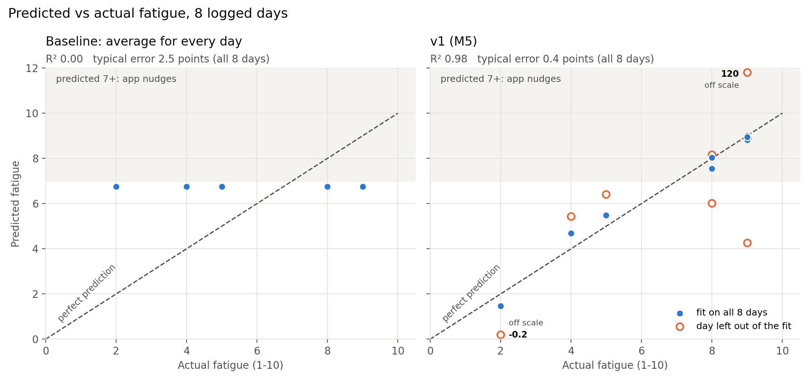
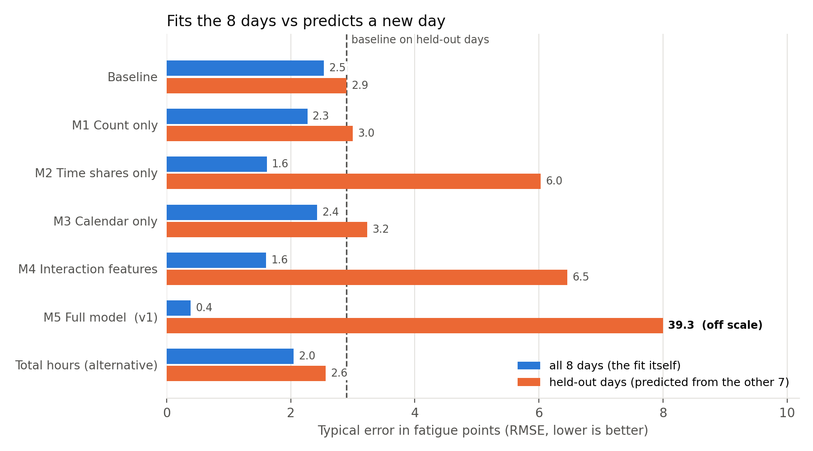

# Social Battery v1: fatigue model results

## Data

- Self-logged by the team (Anny, Bianca, Taeyun, Zaid), 2026-10-14 to 2026-10-19.
- `interactions.csv`: 38 interactions. `daily_fatigue.csv`: 8 person-days (the outcome).
- 8 rows is under 30, so no 70/30 split: v1 is fit on all 8 rows. Leave-one-out (predict each day from the other 7) is reported as a check on new days.

| Person | Date | Interactions | Social share | Academic share | Work share | Weekend | Fatigue | v1 predicted | v1 predicted, day left out | v1 decision |
|---|---|---|---|---|---|---|---|---|---|---|
| Taeyun | 2026-10-14 | 3 | 0.000 | 0.104 | 0.000 | 0 | 8 | 7.55 | 6.02 | nudge |
| Anny | 2026-10-17 | 4 | 0.069 | 0.125 | 0.000 | 1 | 5 | 5.48 | 6.41 | stay quiet |
| Taeyun | 2026-10-18 | 2 | 0.271 | 0.000 | 0.000 | 1 | 9 | 9.01 | 120.03 | nudge |
| Anny | 2026-10-18 | 2 | 0.062 | 0.000 | 0.000 | 1 | 2 | 1.47 | -0.20 | stay quiet |
| Bianca | 2026-10-18 | 5 | 0.052 | 0.000 | 0.083 | 1 | 8 | 8.04 | 8.16 | nudge |
| Zaid | 2026-10-19 | 12 | 0.080 | 0.226 | 0.000 | 0 | 9 | 8.82 | 4.27 | nudge |
| Anny | 2026-10-19 | 4 | 0.014 | 0.042 | 0.000 | 0 | 4 | 4.68 | 5.43 | stay quiet |
| Bianca | 2026-10-19 | 6 | 0.007 | 0.021 | 0.062 | 0 | 9 | 8.95 | 8.88 | nudge |

### Data dictionary (`fatigue_model_data.csv`)

| Column | Meaning |
|---|---|
| `Name` | who logged the day |
| `date` | the day (YYYY-MM-DD) |
| `fatigue_score` | OUTCOME: self-rated fatigue that day, 1 = fully charged, 10 = drained |
| `interaction_count` | number of interactions logged that day |
| `social_day_share` | friend + family minutes / 1,440 |
| `academic_day_share` | lecture + study + group work + teacher minutes / 1,440 (class discussion left out) |
| `work_day_share` | work meeting minutes / 1,440 |
| `weekend_indicator` | 1 = Saturday or Sunday, 0 = weekday |
| `total_hours` | hours of logged interactions that day (used only by the alternative model) |
| `predicted_v1` | v1's predicted fatigue, fit on all 8 days |
| `predicted_v1_held_out` | v1's predicted fatigue when this day is left out of the fit |
| `nudge_v1` | v1's decision: nudge if predicted fatigue >= 7 |

## Model v1: M5 Full model from the team spreadsheet

`fatigue_score ~ interaction_count + social_day_share + academic_day_share + work_day_share + weekend_indicator` (OLS)

| Term | Coefficient | p-value | In plain words (other features held equal) |
|---|---|---|---|
| Intercept | 5.415 | 0.019 | starting point |
| interaction_count | -0.746 | 0.080 | each extra interaction: -0.75 points |
| social_day_share | 36.183 | 0.018 | each hour with friends/family: +1.51 points |
| academic_day_share | 41.986 | 0.045 | each hour of class/study: +1.75 points |
| work_day_share | 110.193 | 0.021 | each hour of work meetings: +4.59 points |
| weekend_indicator | -4.711 | 0.030 | a weekend day: -4.71 points |

R² 0.976, adjusted R² 0.918 (F-test p = 0.058), with 2 residual degrees of freedom: 6 numbers fit to 8 days. A day share is minutes / 1,440, so a share coefficient / 24 is the effect of one hour.

## Fit, baseline vs v1

| | R² | Typical error (RMSE, fatigue points) |
|---|---|---|
| Baseline (average 6.75), all 8 days | 0.000 | 2.54 |
| v1, all 8 days | 0.976 | 0.39 |
| Baseline, leave-one-out | -0.306 | 2.90 |
| v1, leave-one-out | -239.060 | 39.31 |

On all 8 days v1 is nearly exact, but that is expected with 6 numbers fit to 8 days. With a day left out, its predictions swing far off the 1-10 scale (worst: 111 points off), so its predicted numbers should not be shown to users. Its nudge decisions hold up better (see below), because a decision only depends on which side of 7 the prediction falls.

### All candidate models

M1-M5 reproduce `daily_fatigue_regression.xlsx`; total hours is a one-feature alternative.

| Model | Residual df | R² | Adjusted R² | Typical error, all days | Typical error, held-out days | Tired days caught, held-out | False alarms, held-out |
|---|---|---|---|---|---|---|---|
| M1 Count only | 6 | 0.200 | 0.066 | 2.27 | 3.00 | 1 of 5 | 0 |
| M2 Time shares only | 4 | 0.595 | 0.291 | 1.61 | 6.03 | 2 of 5 | 1 |
| M3 Calendar only | 6 | 0.087 | -0.065 | 2.42 | 3.23 | 3 of 5 | 2 |
| M4 Interaction features | 3 | 0.600 | 0.066 | 1.61 | 6.46 | 2 of 5 | 1 |
| M5 Full model (v1) | 2 | 0.976 | 0.918 | 0.39 | 39.31 | 3 of 5 | 0 |
| Total hours (alternative) | 6 | 0.350 | 0.242 | 2.05 | 2.56 | 2 of 5 | 1 |

## Decision and value

Rule: nudge if predicted fatigue >= 7, else stay quiet (`should_nudge`). 5 of 8 logged days were tired days.

Value per user-day (ASSUMED): nudge on a tired day $0.50, nudge on a fine day -$0.20, no nudge on a tired day -$0.50, no nudge on a fine day $0.00. Per year = per user-day x 1,000 users (ASSUMED) x 365 days.

| Rule | Nudges | Tired days caught | False alarms | Tired days missed | Value, 8 days | Per user-day | Per year |
|---|---|---|---|---|---|---|---|
| Baseline (never nudge) | 0 | 0 | 0 | 5 | -$2.50 | -$0.31 | -$114,062 |
| v1, fit on all 8 days | 5 | 5 | 0 | 0 | $2.50 | $0.31 | $114,062 |
| v1, each day left out | 3 | 3 | 0 | 2 | $0.50 | $0.06 | $22,812 |

v1 vs baseline per year: $228,125 better on the days it was fit on, $136,875 better when each day is predicted without seeing it. The second is the more honest figure.

## New input

weekday: 2 h lecture, 1.5 h study, 1 h group work, 1.5 h with friends: 4 interactions, social share 0.062, academic share 0.188, work share 0.000, weekend 0. v1 predicts fatigue 12.6: **nudge**. Baseline: stay quiet.
The predicted score is outside the 1-10 scale, another sign that v1's numbers are unstable; the decision only uses whether it is 7 or more.
